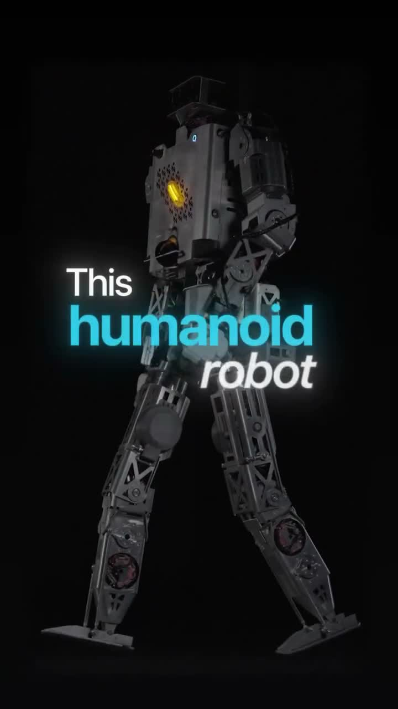
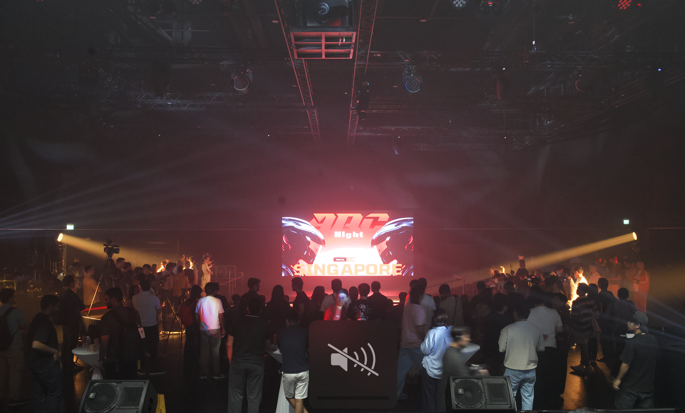

# Humanoids Grew Up This Fall. Three Things Changed.

*Six weeks of news from Shanghai, Savannah, San Francisco and Singapore show where humanoid robotics is heading: toward revenue, toward human skill, and toward a live audience.*

---

> **TL;DR**
> - **Money now follows revenue.** China cooled humanoid IPOs, Agility is weeks from Nasdaq, and Boston Dynamics hired an AI chief as CEO. Capital is still flowing, but investors now want proof the robots earn money.
> - **Humans are now part of what's being sold.** Startups that sell human movement data report $100M+ revenue run-rates. New humanoids are built for remote operation. Even Atlas's new hand needed a human for its hardest demo.
> - **Entertainment is the most practical path to revenue for humanoids today.** People are already paying for theme parks and ticketed fight nights, and those events are where humanoids meet the public and where the hardware gets tested hardest.

---

## 1. Money now follows revenue

*Atlas training for factory work at Hyundai's new application center near Savannah, Georgia. Photo: [Automotive World](https://www.automotiveworld.com/news/boston-dynamics-opens-atlas-training-hub-at-hyundai-plant/)*

In **September**, China's securities regulator reportedly gave banks informal "window guidance" to raise the bar for humanoid robot IPOs [[1]](#sources). Unitree, the sector's first mainland listing, had already fallen roughly 45% from its peak, and was down about 55% by the time the guidance surfaced [[2]](#sources). Companies waiting to list now need to show **recurring revenue and narrowing losses**, not just strong demos [[1]](#sources).

The money is still there. It is going to companies that can show real deployments:

- **US:** On **October 13**, the SEC declared Agility Robotics' merger filing effective. Shareholders vote on **November 2**. If approved, Agility lists on Nasdaq as AGLT with **over $620M in new capital** and **$300M+ in committed Digit orders** [[3]](#sources).
- **US / Korea:** Hyundai and Boston Dynamics opened a center in Georgia in **September** to train Atlas for factory work, part of a plan to deploy **25,000 Atlas units** across Hyundai and Kia plants [[4]](#sources). On **October 6**, Boston Dynamics named **Rohit Prasad**, formerly Amazon's head scientist for AGI, as CEO [[5]](#sources).
- **US:** Tesla is reportedly building **several hundred Optimus robots a week** at Fremont, about ten times its Q2 rate, and is targeting 1,000 a week by year-end [[6]](#sources).
- **China:** AGIBOT rolled out its **20,000th robot** in September [[7]](#sources). On **October 13**, Shanghai set a goal of **8,000 humanoids working in its factories by 2028** [[8]](#sources).

Globally, IDC estimates about **25,000 humanoids shipped in the first half of 2026**, up 432% year over year. It expects that to pass **750,000 a year by 2030** [[9]](#sources).

**The takeaway:** the question is no longer *whether* humanoids will ship. It is *who can make them pay*.

---

## 2. Humans are now part of what's being sold

*▶ Click to watch: "New Hands for Atlas", Boston Dynamics, Oct 1, 2026. Video: [Boston Dynamics on YouTube](https://www.youtube.com/watch?v=4whgw2gLBS8)*

On **October 1**, Boston Dynamics unveiled a new Atlas hand with **13 degrees of freedom, up from 7**. It has dense tactile sensing and is built to use drills, nail guns and welding torches [[10]](#sources). In the launch footage, the drill demo was run by **a remote operator**. A simpler two-ball manipulation was autonomous [[11]](#sources).

This is common across the industry. Human skill used to be treated as a temporary fix until robots became autonomous. Companies are now selling it directly, either as training data or as a product feature:

| Company | What they do | Latest signal |
|---|---|---|
| **Mecka** (US / Canada) | Records people doing real tasks from a first-person view and sells the data to robot labs | **$60M Series B led by Sequoia** (Oct 7), joined by NVIDIA, Microsoft's M12, Qualcomm and Samsung. Says it passed a **$100M revenue run-rate** in June [[12]](#sources) |
| **XDOF** (US) | Collects teleoperation data and data from human workers wearing sensors | In talks at a **~$1.2B valuation**, three months out of stealth, with annualized revenue nearing $50M (Sept 4) [[13]](#sources) |
| **Minerva Humanoids** (US / Germany) | Building "Roger," a humanoid that lets trained specialists do dangerous jobs remotely, operated in VR | **~$10M pre-seed led by General Catalyst** (Oct 6). Targets oil and gas, bomb disposal and HazMat [[14]](#sources) |
| **HTX** (Singapore) | Government center training humanoids for HazMat, post-blast and emergency work | Opened Sept 30 with dedicated **motion-capture, teleoperation and human-demonstration** zones [[15]](#sources) |

*▶ Click to watch: Mecka's Series B film, Oct 8, 2026. Video: [Mecka on YouTube](https://youtu.be/-P6adJ6P6C0)*

*▶ Click to watch: Roger, Minerva's humanoid for hazardous work, is built to be operated by a remote specialist. Video: [Will Cannon (@iamwillcannon) on Instagram](https://www.instagram.com/reels/Deabd8fvAQC/), Oct 12, 2026*

> "Motion, contact, force and geometry aren't on the internet. You can't scrape them, license them or buy them."
> (Mecka [[12]](#sources))

**The takeaway:** language models learned from text people had already written. Robots have to learn from human movement that has never been recorded, and that data is now a paid market. The next question is which human data is worth most. Calm, everyday motion is relatively easy to capture. Fast, forceful decisions made under pressure are much harder to capture and more valuable.

---

## 3. Entertainment is the most practical path to revenue today

*AGIBOT robots at Chimelong Spaceship Park in Zhuhai. Photo: [Robotics 24/7](https://www.robotics247.com/article/agibot-chimelong-launch-large-scale-embodied-ai-theme-park-with-over-300-robots)*

Factories are the long-term prize. But in entertainment, people are already paying to watch humanoids today, years before most factory fleets reach full scale. None of these companies publish revenue yet, so the evidence is in ticket sales and investor money:

- **Zhuhai, China (Sept 24):** AGIBOT and Chimelong opened a theme park with **more than 300 humanoid robots** in its first phase [[7]](#sources). The robots are part of what visitors pay to see.
- **San Francisco (Sept 18):** The league REK put an influencer in a cage against VR-piloted humanoids, and the fight went viral [[17]](#sources). REK hasn't disclosed revenue, but it sells tickets: its next event, an Oct 9 robot-vs-robot "Deathmatch," charged **$69 a seat** [[17]](#sources). One analyst counted about 100 people there, roughly **$6,900 at the door**. He also pointed to a filing showing a fund holding about **$2.5M of REK preferred stock**, with tickets, sponsorships, media rights and merchandise listed as planned revenue [[21]](#sources). The numbers are small, but the pattern matters: a viral bout online turns into paying fans in the room. Within two weeks of the Sept 18 fight, the **California State Athletic Commission** warned organizers that unsanctioned human-vs-robot fights could be a misdemeanor [[18]](#sources).

*REK's human-vs-humanoid bout in San Francisco. Photo: [Fox News](https://www.foxnews.com/tech/human-vs-humanoid-robot-cage-fight-goes-viral)*

Not every headline here is about money yet. In **September**, Unitree released footage of a G1 sparring with a human **with no teleoperator**. It calls this the first fully autonomous humanoid combat, though no one has independently verified the claim [[16]](#sources). It isn't a product yet. It is a sign of how fast the technology behind these shows is improving.

*▶ Click to watch: Unitree's autonomous combat demo, Sept 7, 2026. Video: [Unitree Robotics on YouTube](https://www.youtube.com/watch?v=qkIJELDgULA)*

The format that pushes the machines hardest without putting people at risk is **robot vs. robot, with elite humans piloting**. On **October 7**, ARC Night staged Singapore's first full-sized humanoid fight night. Muay Thai, MMA, boxing and kung fu athletes, including national and international champions, wore **full-body motion-capture suits** and piloted Unitree G1 and EngineAI T800 humanoids in real time in front of 380+ people [[19]](#sources). The athlete supplied the intent and the robot handled balance and execution. Only machines took the hits.

*ARC Night at \*SCAPE, Singapore, Oct 7: more than 380 people came to watch athlete-piloted humanoids fight. Photo: Katena*

**The takeaway:** live entertainment ties the first two trends together. Audiences are already buying tickets, while factory deployments are still ramping. It is the toughest public test of humanoid hardware. And it produces some of the hardest human data to collect: fast, contact-heavy decisions made under pressure.

---

## What to watch next

1. **Oct 21, Tesla's Q3 results.** This is the first chance for an official Optimus production number since the Fremont ramp began [[20]](#sources)[[6]](#sources).
2. **Nov 2, Agility's shareholder vote.** If it passes, the US gets its first publicly listed pure-play humanoid company [[3]](#sources).
3. **Rules for robot combat.** California has drawn its first line between sport and safety [[18]](#sources). How other regulators respond will shape which formats can grow.

Building humanoid bodies is now a crowded and well-funded race. Teaching those bodies human skill, in factories, in emergencies and in front of a crowd, is still early, and that is where the opportunity is.

---

## Sources

*All sources published September 1, 2026 or later.*

1. Reuters via Khaleej Times, "China curbs humanoid IPOs after Unitree's volatile debut, The Information reports," Sept 9, 2026. https://www.khaleejtimes.com/business/china-curbs-humanoid-ipos-after-unitrees-volatile-debut-the-information-reports
2. The Next Web, "China slows humanoid robot IPOs after Unitree," Sept 21, 2026. https://thenextweb.com/news/china-slows-humanoid-robot-ipos-unitree
3. Business Wire via Finviz, "Agility Robotics and Churchill Capital Corp XI S-4 declared effective by SEC," Oct 13, 2026. https://finviz.com/news/402113/agility-robotics-and-churchill-capital-corp-xi-s-4-registration-statement-declared-effective-by-sec-in-connection-with-proposed-business-combination · Securities.io: https://securities.io/agility-robotics-to-raise-over-620m-as-sec-clears-proposed-merger-s-4/
4. Automotive World, "Boston Dynamics opens Atlas training hub at Hyundai plant," Sept 22, 2026. https://www.automotiveworld.com/news/boston-dynamics-opens-atlas-training-hub-at-hyundai-plant/ · autoevolution, Oct 8, 2026: https://www.autoevolution.com/news/hyundai-is-now-officially-training-humanoid-robots-for-factory-jobs-at-metaplant-america-276738.html
5. Robotics 24/7, "Boston Dynamics names Rohit Prasad as new CEO," Oct 6, 2026. https://www.robotics247.com/article/boston-dynamics-names-rohit-prasad-as-new-ceo · Manufacturing Dive, Oct 7, 2026: https://www.manufacturingdive.com/news/boston-dynamics-hires-ceo-former-amazon-ai-rohit-prasad/832360
6. Electrek (citing The Information), Sept 25, 2026. https://electrek.co/2026/09/25/tesla-optimus-production-ramp-hands-ai-generalization-problems/
7. Robotics 24/7, "AGIBOT, Chimelong launch large-scale embodied AI theme park with over 300 robots," Sept 28, 2026. https://www.robotics247.com/article/agibot-chimelong-launch-large-scale-embodied-ai-theme-park-with-over-300-robots
8. Seoul Economic Daily, "Shanghai targets 8,000 humanoid robots in factories by 2028," Oct 14, 2026. https://en.sedaily.com/international/2026/10/14/shanghai-targets-8000-humanoid-robots-in-factories-by-2028 · The Paper (Chinese): https://m.thepaper.cn/newsDetail_forward_34235219
9. Robotics & Automation News, "IDC data shows Agibot led global humanoid robot shipments in H1 2026," Oct 2, 2026. https://roboticsandautomationnews.com/2026/10/02/idc-data-shows-agibot-led-global-humanoid-robot-shipments-in-h1-2026/105463/ · Humanoids Daily, Sept 30, 2026: https://www.humanoidsdaily.com/news/idc-h1-2026-humanoid-shipments-agibot
10. The Robot Report, "Boston Dynamics drops pinkie on new humanoid hand," Oct 1, 2026. https://www.therobotreport.com/boston-dynamics-drops-pinkie-on-new-humanoid-hand/ · Korea Herald: https://www.koreaherald.com/article/10891794
11. Notebookcheck (Spanish edition), "El robot Atlas de Boston Dynamics estrena nuevas manos," Oct 2026. https://www.notebookcheck.org/El-robot-Atlas-de-Boston-Dynamics-estrena-nuevas-manos.1413806.0.html
12. Mecka, Series B announcement, Oct 7, 2026. https://mecka.ai/news/series-b · TechCrunch: https://techcrunch.com/2026/10/07/robot-data-startup-mecka-ai-nabs-60m-from-sequoia/ · BetaKit: https://betakit.com/mecka-ai-reveals-60-million-usd-series-b-round-backed-by-sequoia-nvidia/
13. TechCrunch, "XDOF, just three months out of stealth, is in talks for a Series B at a $1.2B valuation," Sept 4, 2026. https://techcrunch.com/2026/09/04/xdof-just-three-months-out-of-stealth-is-in-talks-for-a-series-b-at-a-1-2b-valuation/
14. The AI Insider, "Minerva Humanoids emerges from stealth with $10M," Oct 6, 2026. https://theaiinsider.tech/2026/10/06/minerva-humanoids-emerges-from-stealth-with-10m-in-funding-to-develop-robots-for-hazardous-work/ · Robotics & Automation News, Oct 7, 2026: https://roboticsandautomationnews.com/2026/10/07/minerva-humanoids-raises-10-million-to-develop-robots-for-dangerous-industrial-jobs/105619/
15. HTX, "HTX launches H2RC to train humanoid robots for public safety," Oct 1, 2026. https://www.htx.gov.sg/whats-happening/all-news---events/all-news/2026/seizing-the-initiative-htx-launches-h2rc-to-train-humanoid-robots-for-public-safety
16. Interesting Engineering, "Humanoid robot learns to fight autonomously," Sept 8, 2026. https://interestingengineering.com/ai-robotics/humanoid-robot-learns-to-fight-autonomously · Official video: https://www.youtube.com/watch?v=qkIJELDgULA
17. Fox News, "Human vs. humanoid robot cage fight goes viral," Oct 5, 2026. https://www.foxnews.com/tech/human-vs-humanoid-robot-cage-fight-goes-viral · Dexerto, Oct 8, 2026: https://www.dexerto.com/entertainment/robotics-company-served-cease-and-desist-over-human-vs-robot-fights-3416650/
18. Futurism, "California government officials order robot cage fight to cease," Oct 2, 2026. https://futurism.com/robots-and-machines/california-government-officials-robot-cage-fight-cease
19. PR Newswire, "ARC stages Singapore's first full-sized humanoid fight night," Oct 9, 2026. https://www.prnewswire.com/apac/news-releases/arc-stages-singapores-first-full-sized-humanoid-fight-night-302903360.html
20. Tesla, Q3 2026 earnings date announcement (SEC Form 8-K exhibit). https://www.sec.gov/Archives/edgar/data/0001318605/000162828026064366/exhibit991111111.htm
21. Bret Kerr (Substack), "The crowd is paying to watch the prototype," Oct 14, 2026. https://bretkerr.substack.com/p/the-crowd-is-paying-to-watch-the

*Video covers link to the originals, credited to their creators: Boston Dynamics (https://www.youtube.com/watch?v=4whgw2gLBS8), Mecka (https://youtu.be/-P6adJ6P6C0), Will Cannon (https://www.instagram.com/reels/Deabd8fvAQC/), Unitree Robotics (https://www.youtube.com/watch?v=qkIJELDgULA).*
